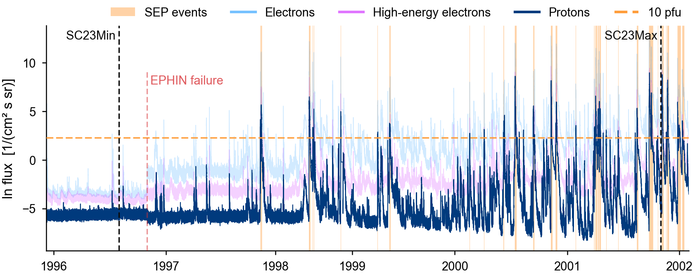
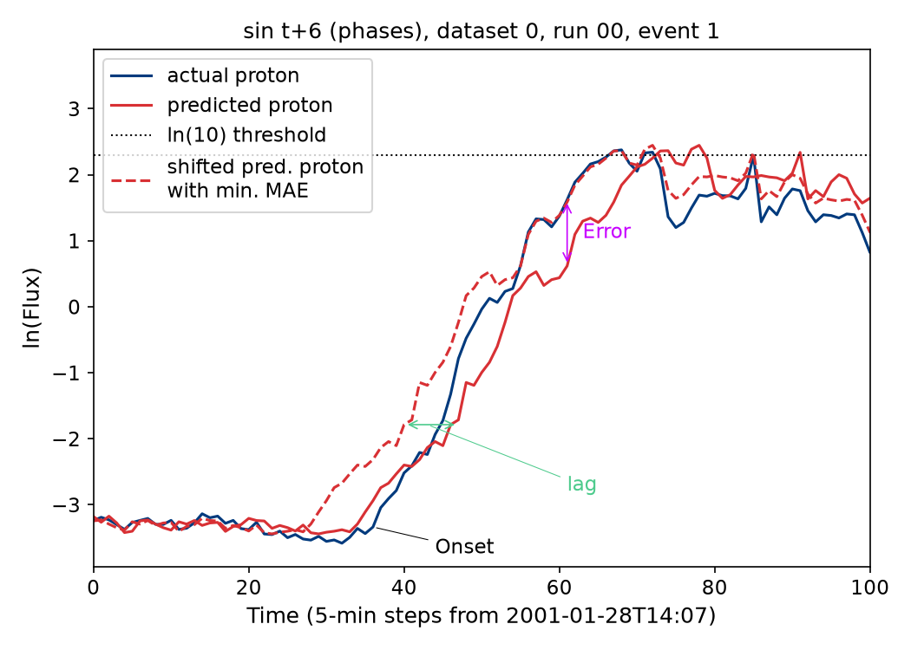
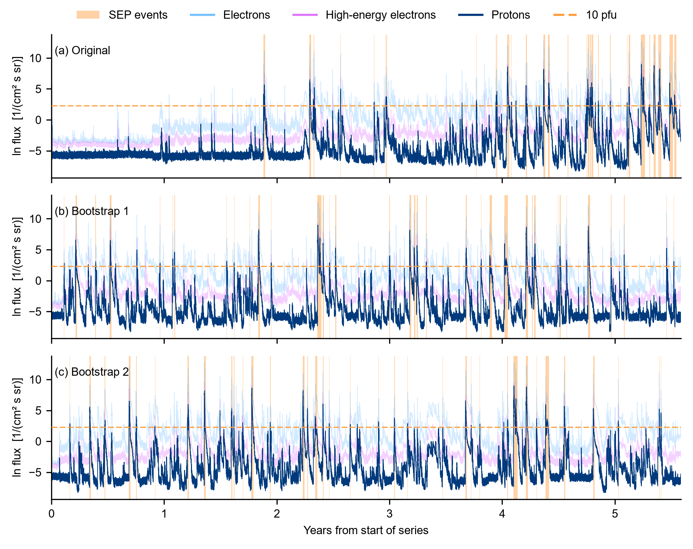
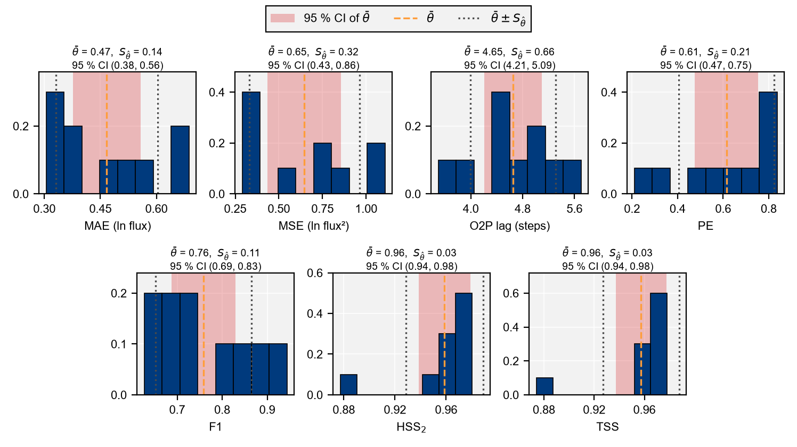
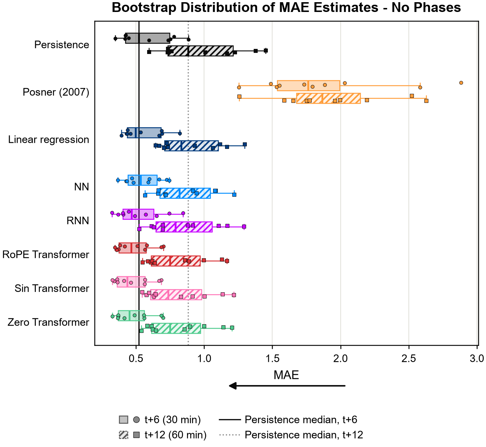
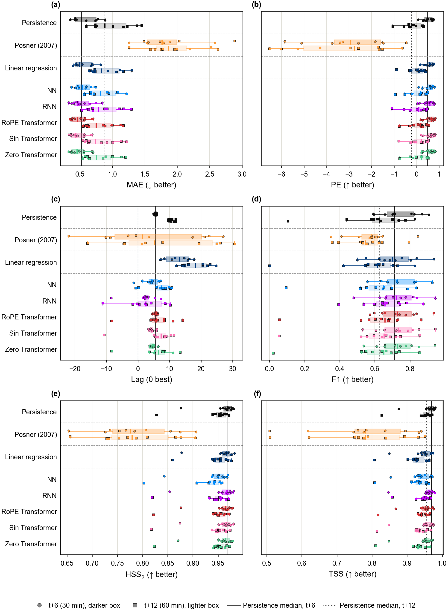
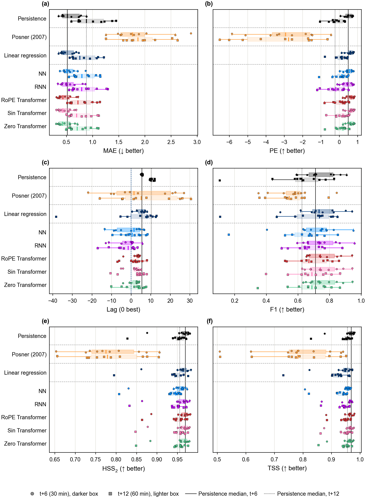
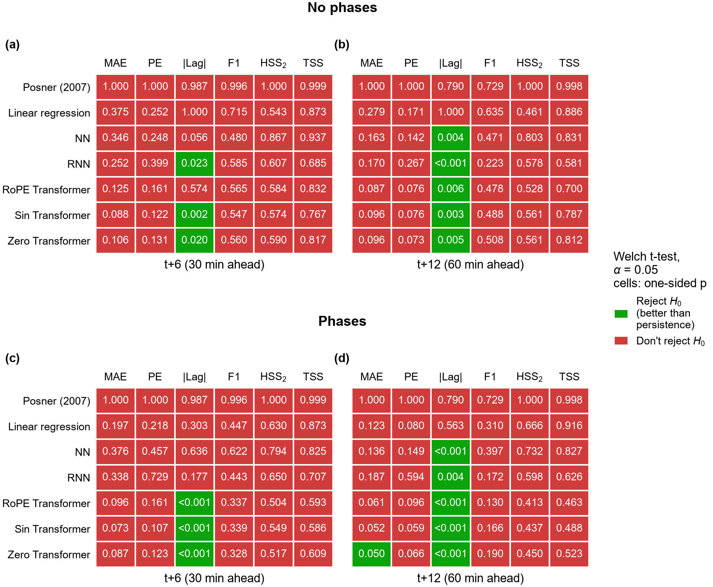
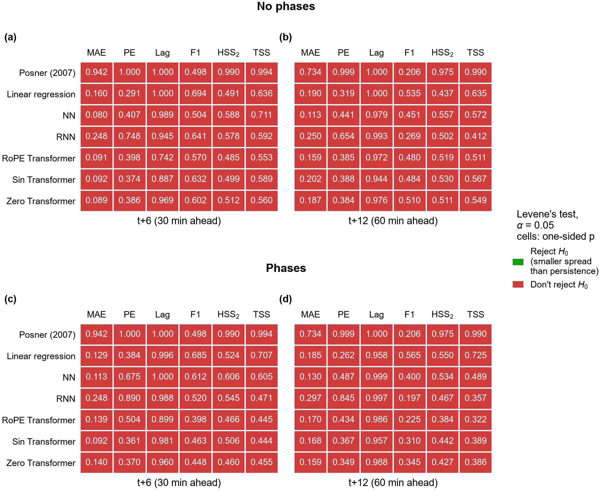

# A Comparative Analysis of High Energy Proton Flux Measured at Lagrange Point 1 Forecasting Hetero Models with Time Series Transformers

**Lewis Adkins** — Space Weather Lab Group, George Mason University

*Space Weather*

**Key points:** TBD; TBD; TBD

# Abstract

# Introduction

The space weather environment is home to many hazards that put humans and their artificial satellites at risk. Solar Energetic Particles (SEPs) are bursts of high energy protons $>10$ MeV, electrons and $\alpha$ particles following the magnetic field lines from the Sun reaching relativistic speeds $(\approx 0.9c)$. Coronal Mass Ejections (CMEs) drive shock waves that accelerate SEPs to tens of GeV and flux $\geq 10$ MeV making them difficult to shield (Reames, 2021). SEPs are one of many species in the extra-terrestrial ecosystem; however, protons $>10$ MeV are one of the greatest offenders damaging electronic components on satellites, aircraft, high frequency communications, and human health, making reliable forecasting essential (Eastwood et al., 2017). SEP relativistic electrons ($0.95c$, $1$ MeV) are always present during storm events and precede slower incoming SEP ($0.25c$, $30$ MeV) protons due to less scattering (Núñez et al., 2018). This simple relationship has been the basis of a portion of forecast models predicting high energy protons at $10$ pfu.

Physics models that simulate heliospheric transport and particle acceleration processes are computationally expensive and are usually studied to understand underlying processes rather than generating predictions. The issue with all physics-based SEP models is that they may have poorly constrained free parameters such as diffusion coefficients and which specific magnetic field line to select to produce a prediction for the particle spectrum at the observer's location. Empirical and statistical models provide predictions but rely heavily on historical correlations leaving probabilities of an event to occur (Whitman et al., 2023). Together, physics, statistical, and empirical models are limited by uncertain inputs and must trade off realistic behavior with forecast timeliness (Yu et al., 2026a).

Machine Learning (ML) models have had major breakthroughs in the application of space weather due to the large availability of in situ observations and recent advancements in Graphics Processing Unit (GPU) computing (Camporeale, 2019). ML models predicting SEPs with space weather properties demonstrated improved results establishing reliable forecast methods (Posner et al., 2024; Yu et al., 2026a; Yu et al., 2026b; Dayeh et al., 2024). With the recent development of self-attention architectures, transformers, (Vaswani et al., 2017), there is still room for improvements. Recurrent models struggle with long-range dependencies, convolution models require deep stacking to enlarge receptive fields, and both scale suboptimally to high-dimensional and high-volume data (Zhao et al., 2026). Transformers evaluate the totality of input data in parallel to generate reliable, accurate outputs. Their architecture allows for optimal scaling (Vaswani et al., 2017). Because the introduction of transformers is recent, there are limited applications in predicting space weather, therefore a fully realized comparative analysis of forecasting performance is necessary and would provide much insight for other modelers.

We analyze time series SEP data (5-minute cadence) recorded by the Solar and Heliospheric Observatory Comprehensive Suprathermal and Energetic Particle Analyzer–Electron Proton Helium Instrument (SOHO-COSTEP-EPHIN) located at Lagrange Point 1 (L1). We compare transformer models to a collection of SEP forecasting models of all types under a battery of assessments. These include multilayer perceptron neural network (NN) and recurrent neural network (RNN) models (Torres et al., 2025), a physics model using an electron increase parameter matrix (Posner, 2007), and simple statistical and empirical models, persistence and linear regression. Our tests include a fixed 2-hour time window of particle fluxes as an input to predict a single proton flux value at either $30$ minutes or $60$ minutes ahead. Additionally, expanding the input time window, increasing forecasting time, and parameter sizes of our models will give us a holistic diagnosis of the performances between the models.

Section 3 will discuss related work on transformer applications. Section 4 will report which transformer models we developed and why, and reintroduce previously mentioned models more in depth. A summary of selected metrics will be provided to compare forecasting accuracy. Finally, we provide an outline of our battery assessment in detail. Section 5 will show our evaluation of the model performances for each test with analysis. Section 7 will summarize and discuss future work, potential improvements and limitations.

# Related Work

**SEP ML Forecasting** Machine learning has been applied to SEP forecasting mainly as an event-occurrence problem, using solar-source precursors. Boubrahimi et al. (2017) treated GOES proton and X-ray fluxes as multivariate time series and used interpretable decision trees to predict $>100$ MeV SEP events, finding that the correlation between proton and X-ray channels is an early precursor. Engell et al. (2017) developed SPRINTS, which forecasts SEP events from GOES X-ray flare metadata using expert-guided, statistical, and machine-learned decision tree models. Laurenza et al. (2018) adapted the ESPERTA empirical model, which uses flare location, soft X-ray fluence, and 1 MHz radio fluence, to provide short-term warnings of moderate-to-extreme solar proton events. Aminalragia-Giamini et al. (2021) trained neural networks on GOES soft X-ray measurements of solar flares to predict whether a flare would be followed by an SEP event. Lavasa et al. (2021) treated SEP prediction as an imbalanced binary classification problem and compared several machine learning methods on flare and coronal mass ejection data, finding CME speed, CME width, and flare soft X-ray fluence to be the most informative features. Kasapis et al. (2022) used support vector machines and regression models on active region magnetograms from SOHO/MDI to forecast SEP events during Solar Cycle 23. These studies predict whether an event will occur from solar-source precursors, using decision trees, support vector machines, ensembles, and feedforward neural networks. In contrast, this study forecasts the time profile of the >10 MeV proton flux from relativistic electrons measured in situ at L1 (Posner, 2007; Torres et al., 2025), and evaluates attention-based transformer architectures, which have not been applied to this task.

**Time Series Transformer Applications** Since their introduction for machine translation (Vaswani et al., 2017), transformers have been adapted to time series forecasting across many domains (Zhao et al., 2026). Early forecasting variants focused on interpretability and efficiency: the Temporal Fusion Transformer combines gated variable selection with multi-head attention to produce interpretable multi-step forecasts (Lim et al., 2021), Informer reduces the cost of self-attention from $O(L^2)$ to $O(L\log L)$ for long input sequences (H. Zhou et al., 2021), and the Time Series Transformer uses learnable positional encodings with unsupervised pre-training to perform well when data are scarce (Zerveas et al., 2020). More recent models such as Chronos treat forecasting as a language-modeling task and pre-train on many datasets to forecast without task-specific training (Ansari et al., 2024). These architectures have been applied to stock market prediction, clinical and physiological monitoring, battery state-of-health estimation, and traffic flow forecasting (Cai et al., 2020; Zhao et al., 2026), but rarely to space weather. Their advantage is not guaranteed, however. Simple baselines can match or beat them: a naive forecast that repeats the last observed value outperformed transformer models on exchange-rate data (Zeng et al., 2022), and transformers tend to overfit when training data are limited (Zhao et al., 2026). Zhao et al. (2026) further note that their performance depends strongly on the choice of positional encoding. These findings motivate the comparison in this study, which evaluates three positional encodings against persistence and other baselines on a small set of 39 SEP events.

# Approach

SEP events consist of high energy particles such as protons, electrons and alpha particles, with protons being the highest risk to space and ground-based infrastructure (Wilkinson et al., 1991). At 1 AU, relativistic electrons experience less scattering than protons when traveling to Earth. Because of this, an early warning forecast model can be created that only uses preceding relativistic electrons to warn us of high energy protons (Posner, 2007; Torres et al., 2025). A time series of raw particle channels from COSTEP is used for forecasting using time series transformers. We build a series of transformer models with different encoding architectures that capture the correlation of proton and electron intensity using multiple methods.

In Section 4.1 we discuss the particle time series and the instrument. Section 4.3 provides an explanation of what transformers are and how they differ from previous machine learning models. Section 4.4 justifies the chosen positional encoding architectures.

## Input

**Figure 1.** SOHO COSTEP-EPHIN dataset from 1995-2002

The particle channel data are obtained from the Comprehensive Suprathermal and Energetic Particle Analyzer - Electron Proton Helium Instrument (COSTEP-EPHIN) on the Solar and Heliospheric Observatory (SOHO). SOHO first launched on December 2nd 1995 to take in situ measurements of energy deposition and particle acceleration in the solar atmosphere (*SOHO Comprehensive Suprathermal and Energetic Particle Analyzer (COSTEP) Electron Proton Helium Instrument (EPHIN) Intensity Level 3 1-minute Data in CDF Format*, 2026). SOHO orbits between Earth and the Sun around Lagrange Point 1 (L1), which is approximately 1.5 million kilometers from Earth. L1 is an ideal location for space weather instruments as any satellite situated there enjoys an uninterrupted view of the Sun. The EPHIN instrument switched to a failure mode that reduced the energy ranges it was able to read in October 1996 (Kühl & Heber, 2019). Torres et al. (2025) provide a dataset of 39 identified SEP events using the particle data recorded by COSTEP-EPHIN. Two relativistic electron intensity channels $\geq$0.25 and $\geq$0.67 MeV (Müller-Mellin et al., 1995) are the precursors for our incoming protons. Proton channels are separated into four energy channels (P4, P8, P25, P41) each corresponding to different energy ranges. Proton channel P4 corresponds to the energy range $4.3 - 7.8 \text{ MeV}$, P8 corresponds with $7.8-25 \text{ MeV}$, P25 corresponds with $25 - 40.9 \text{ MeV}$, and P41 corresponds with $40.9 - 53 \text{ MeV}$. To retrieve a $>10$ MeV proton flux channel, a sum of the energy integrated fluxes P8, P25, and P41 channels minus the range $7.8-10$ MeV is performed. The latter channel is determined by a power-law spectrum interpolation of the first two channels, P4 and P8, differential fluxes and their mean energies (Torres et al., 2025).

SEP events were then identified for storms larger than 10 proton flux units (pfu). Each event is partitioned into phases to highlight definable features: Onset, Threshold, Peak, End. The onset is defined as the time when the flux rises three times the error bar above the pre-event background, the threshold is when the flux first crosses over 10 pfu and the end time is when it drops again below 2 pfu (Torres et al., 2025).

## Why Transformers

The computational power of a transformer can be parallelized requiring fewer operations. Long range dependencies can be handled much more easily with larger window lengths. Inputs pass forward and back signals that help to make predictions. As the input window length grows, the harder it is to learn long range dependencies on RNN and NN models (Zhao et al., 2026). Self-attention could yield more interpretable models (Vaswani et al., 2017). NN and RNN scale suboptimally to large datasets compared to transformer models (Zhao et al., 2026). Physics based models simulating particle acceleration and transport processes are computationally expensive (Camporeale, 2019; Yu et al., 2026a; Kasapis et al., 2026). Furthermore, limitations in forecast timeliness force a trade-off with realism (Yu et al., 2026a).

## Transformers

The original transformer consists of encoder-decoder stacks with built-in self-attention modules that translate inputs $\mathbf{X}$ into vectors $\mathbf{Z}$, identify correlations and relationships, and output a sequence of predictions $\mathbf{Y}$. The encoder stack handles the $\mathbf{X \rightarrow Z}$ transformations while the decoder handles $\mathbf{Z \rightarrow Y}$ (Vaswani et al., 2017). Because we are only predicting a singular timestamp of proton flux in the future, we drop our decoder stacks as their purpose is to generate a sequence of outputs from $\mathbf{Y}$ rather than one value (Vaswani et al., 2017).

For our time series data, we use two hours of historical particle flux data of our two electron channels and $>10$ MeV proton channel. The magnitude in differences of fluxes between our channels is large enough to cause unstable training and testing; therefore, we apply a natural $\log$ transformation to the entire dataset, compressing the mean and variance on the same scale. The standard method is to subtract the mean and divide by the standard deviation, a process called “standardization.” To ensure our NN and RNN align with Torres et al. (2025) model results, the prior method is selected instead to replicate Torres et al. (2025). We set $t$ to indicate present time. Because of the cadence of 5 minutes, $t - 25$ timestamps creates twenty-four 5-min intervals of particle flux forming a window of inputs before and including the current time. For each window, we define an input sample:

$$
\mathbf{X} \in \mathbb{R}^{l \times v} = \mathbb{R}^{25 \times 3}
$$

where $l$ is the length of the input window and $v$ is the number of variates. A process that translates our particle fluxes at each timestep into transformer readable vectors, embedding, is calculated by:

$$
\mathbf{
U} = \mathbf{XW_p}^T + \mathbf{1b_p}^T, \mathbf{1} \in \mathbb{R}^{l \times 1}
$$

$\mathbf{W_p} \in \mathbb{R}^{d \times v}$ and $\mathbf{b_p} \in \mathbb{R}^{d}$ are the weight matrix and bias vector, respectively. They are initialized randomly at the start of training and then used to compute $\mathbf{U} \in \mathbb{R}^{l \times d}$. After every training cycle, these parameters are updated to minimize the loss. $d$ is the dimension of the embedding vector that represents our inputs. For large $d$, inputs are characterized at a higher resolution allowing models to learn finer grain patterns at the cost of computational power and risk of overfitting. The number of parameters in a model is proportional to the size of $\mathbf{W_p}$ and $\mathbf{b_p}$ (Vaswani et al., 2017; Zerveas et al., 2020).

**Table 1.** Total number of trainable parameters for each model.

| Model | Parameters |
|---|---|
| NN | 2,311 |
| RNN | 3,181 |
| Sinusoidal | 3,361 |
| Zero-Init | 3,761 |
| RoPE | 3,361 |

To match parameter size of Torres et al. (2025) we use $d = 16$. Our transformer models are slightly larger than the RNN and NN provided by Torres et al. (2025). A model size $d=8$ would greatly reduce the models far below the parameter count of RNN and NN. Table 1 provides a count of all parameters in each machine learning model in this study. The RNN and NN are implemented with two layers: one layer is hidden with 30 units and then a second dense single output layer. The RNN is comprised of Gated Recurrent Units (GRU) for its hidden layers while the NN uses hidden layers. The NN model uses the same three channels for 25 timestep intervals. The RNN has the 30 GRU units plus our three channel input (Torres et al., 2025). All models (RNN, NN, transformers) minimize the loss function with mean squared error during training.

*[TikZ diagram — see PDF]*

**Figure 2.** Generic transformer architecture where positional encoding methods are indicated to show the difference between all models

## Positional Encoding Methods

Transformer models compute updates in $\mathbf{W_p}$ and $\mathbf{b_p}$ in parallel. This allows for large input sequences to be read at the same time without “forgetting” related timestamps that are far apart from each other in the window. Any reshuffling of the vectors that make up $\mathbf{U}$ has no effect on the update calculation. Additional positional information must be injected to bring context to our input window (Vaswani et al., 2017). For all input vectors $\mathbf{u_w}$ we add a $\mathbf{w_{\text{pos}, w}}$:

$$
\mathbf{U' = U + W_{\text{pos}}} , \mathbf{W_\text{pos}} \in \mathbb{R}^{l \times d}
$$

RNNs and NNs, in contrast, read the inputs sequentially learning order inherently.

The particle flux dataset is small; therefore, different positional encoding (PE) could affect predictions. PE is said to be a major factor in “length generalization,” the ability to extrapolate effectively to large sequences of events from smaller training context windows. Transformers without PE outperform those with explicit PE methods (Kazemnejad et al., 2023).

### Sinusoidal Positional Encoding

Sinusoidal positional encoding was the default mechanism in the originally proposed transformer architecture paper (Vaswani et al., 2017). Colloquially, transformers built in this architecture are referred to as “vanilla” models; however, for this study to differentiate between the architectures we will say sinusoidal model. It is an absolute position encoding method that uses sine and cosine functions of different frequencies to encode the positional indexes of tokens in a sequence. The input window is split into smaller chunks called tokens. For each token, a vector of dimension $d$ is generated. The vector is determined by the position, $pos$, in the window and the length of the vector, $d$. $i$ is the dimension of the PE vector. Odd and even indexes in the vector are determined by (2) and (1) respectively. This gives us a new vector $\mathbf{w_\text{pos}} \in \mathbb{R}^{l \times 1}$. Equations (1) and (2) are chosen to represent a linear relationship between two encoded positions.

$$
PE_{(pos,2i)} = \sin (pos / 10000^{2i/d})
$$

$$
PE_{(pos,2i+1)} = \cos(pos/10000^{2i/d})
$$

The frequency decreases exponentially by a scale factor as the dimension index increases. At large vector indexes the frequency greatly decreases, taking on a more linear relationship. The positions are encoded uniquely based on value and position, allowing it to scale to unlimited sequence lengths (Vaswani et al., 2017).

### Rotary Positional Embedding

Rotary Positional Embedding (RoPE) is a PE method that stores the position information of a token $m$ in a sequence in the total rotation of the query and key vectors by some angle $\theta_i$. The rotation amount is calculated by:

$$
\theta_i = 10000^{-2(i-1)/d}, \left\{i \in \mathbb{Z} \Bigg| 1 \leq i \leq \frac{d}{2}\right\}
$$

The rotation matrix is then applied to the token:

$$
r_{\theta_i} = 
\begin{bmatrix} 
\cos (m\theta_i) & -\sin (m\theta_i) \\
\sin (m\theta_i) & \cos (m\theta_i )
\end{bmatrix}
$$

To generalize we stack our rotation values $\Theta = [\theta_1, \dots, \theta_{d/2}]$ to form the rotary matrix:

$$
\mathbf{R}^{d}_{\Theta,m} =
\begin{pmatrix}
r_{\theta_1} & \mathbf{0} & \cdots & \mathbf{0} \\
\mathbf{0} & r_{\theta_2} & \cdots & \mathbf{0} \\
\vdots & \vdots & \ddots & \vdots \\
\mathbf{0} & \mathbf{0} & \cdots & r_{\theta_{d/2}}
\end{pmatrix}
= \operatorname{diag}\!\left(r_{\theta_1}, r_{\theta_2}, \dots, r_{\theta_{d/2}}\right)
$$

where each $\mathbf{0}$ is a $2 \times 2$ block of zeros, so $\mathbf{R}^{d}_{\Theta,m} \in \mathbb{R}^{d \times d}$.

Unlike Section 4.4.1 and Section 4.4.3, the transformations are applied directly to the self attention block as illustrated in Figure 2, see Section 4.5. The attention weight between a query–key pair in a sequence, $\mathbf{q}_m^T \mathbf{k}_n$, where $n$ is the position of the key vector, is:

$$
\mathbf{q}_m^T \mathbf{k}_n = \mathbf{x}^T\mathbf{W}_q\mathbf{R}_{\Theta, n-m}^d \mathbf{W}_k\mathbf{x}_n
$$

where $ \mathbf{R}_{\Theta, n-m}^d = (\mathbf{R}_{\Theta, m}^d)^T \mathbf{R}_{\Theta, n}^d$.

A property of RoPE is long-term decay. This means that pairs of query-key at large relative distance will have less connection than those that are close to each other (Su et al., 2021). For our flux data, this would coincide with the idea from Posner (2007) that only a short-term window of relativistic electrons is required to accurately predict future proton storms from 30 minutes to an hour.

### Zero-Initialized

Zero-Initialized positional encoding is another absolute positional encoding method that sets all positional encoding parameters in a transformer to zero at the start of training. Positions of a timestamped flux have equal effects on each other at the start. As training continues, near timestamped fluxes learn to correlate to each other rather than further ones. This contrasts with sinusoidal encoding, whose starting values are nonzero. This makes it reliable for generalization which is ideal for SEP data made almost entirely of background fluxes (Torres et al., 2025). Small, near-zero initializations sampled with normal distributions were found to perform better than larger ones (Ito et al., 2024).

Most timestamps in the relatively small proton electron flux dataset are near zero background values. Larger starting weights already contain background information included leading to forecasting more background in the future during the early portion of training. It is not until after rounds of epochs the model unlearns patterns to map rising phases in fluxes to make accurate predictions.

## Self-Attention

After computing our new input vectors with added PE, they can be fed into our multi-head attention block. To do this we first have to define our $QKV$ matrices. Randomly initialized weight matrices $W_i^{QKV} \in \mathbb{R}^{d \times d_k}$ are procured. $d_k =d/h$ where $h$ is the number of heads. Our $QKV$ matrices are therefore:

$$
\begin{aligned}
Q = U'W_i^Q\\
 K = U' W_i^K\\
 V = U'W_i^V
\end{aligned}
$$

where $i$ is the index of the head. For Multihead:

$$
\text{MultiHead}(Q,K,V) = \text{Concat}(\text{head}_i)W^O
$$

and

$$
\text{head}_i = \text{softmax}\left(\frac{Q^TK}{\sqrt{d_k}}\right)V
$$

$W^O$ is the output projection of the attention layer.

## Statistical and Empirical Models

A persistence model as a baseline is included in our study. It is a simple nowcast model in which the predicted proton flux value is the current proton flux value. The forecasting matrix of Posner (2007) is also compared across the same metrics.

A multivariate linear regression model that reads in our three channels of particle fluxes will also be used as a baseline for our transformer.

# Experimental Evaluation

Our evaluation has two objectives. The first is predicting the proton flux 30 minutes ($t+6$) and 60 minutes ($t+12$) into the future. The second is whether our models can predict the occurrence of SEP events with an advance warning system.

## Evaluation of SEP Time-Intensity Profile Prediction

### Metrics

To quantify the performance of predicting proton flux intensity we use four continuous deterministic variable regression metrics and three binary classification scores (Camporeale, 2019). The continuous variable metrics are measured for each event while the binary classifications are computed over the entire flux dataset.

**Table 2.** Evaluation metrics for continuous proton flux prediction and binary SEP event classification. $y_i$ and $\hat{y}_i$ are the true and predicted flux at time step $i$, $\bar{y}$ is the mean true flux, and $N$ is the number of time steps. For lag, $x_i$ and $\hat{x}_i$ are the true and predicted flux within the onset-to-peak window of an event, and $\tau$ is the time shift in 5-minute steps. TP, TN, FP, and FN are the numbers of true positive, true negative, false positive, and false negative event forecasts.

| Continuous variable metrics | Binary classification metrics |
|---|---|
| $\displaystyle \text{MAE} = \frac{1}{N}\sum_{i=1}^{N} \left| \hat{y}_i - y_i \right|$ | $\displaystyle \text{HSS}_2 =\frac{2\left(TP \cdot TN - FN \cdot FP\right)}{(TP + FN)(FN + TN) + (TP + FP)(FP + TN)}$ |
| $\displaystyle \text{MSE} = \frac{1}{N}\sum_{i=1}^{N} \left( \hat{y}_i - y_i \right)^2$ | $\displaystyle \text{TSS} = \frac{TP}{TP + FN} - \frac{FP}{FP + TN}$ |
| $\displaystyle \text{PE} = 1 - \frac{\sum_{i=1}^{N} \left( \hat{y}_i - y_i \right)^2}{\sum_{i=1}^{N} \left( y_i - \bar{y} \right)^2}$ | $\displaystyle \text{F1} = \frac{2\,TP}{2\,TP + FP + FN}$ |
| $\displaystyle \text{Lag} = \operatorname{arg\,min}_{\tau}\frac{1}{N}\sum_{i=1}^{N} \left| \hat{x}_{i+\tau} - x_i \right|$ | |

The metrics are standard in time series forecasting benchmarks except for lag, which measures if a prediction is on time, too late or too early. We shift our predicted protons between the onset and peak of each event to align with the true protons and measure MAE at each shift. Once we have the minimum value of MAE we measure the time lag (Torres et al., 2025).

**Figure 3.** Lag observed on event 1 from sinusoidal transformer.

For each machine learning model we run two tests for each lead time. A run with labeled classification of the phases of an event is known as the “phases” results and the other where the models learn the phases on their own is labeled “no phases.”

### Resampled Time Series Block Bootstrapping

The resample bootstrap is a statistical process that measures the accuracy of our estimated metrics $\hat{\theta}$ with standard error $\hat{\sigma}$. With the standard errors we can then approximate confidence intervals of our unknown parameter $\theta$ (Efron & Tibshirani, 1986). All metrics are computed with a $95 \%$ confidence interval.

For a time series, a variation of the bootstrap, Moving Block Bootstrap (MBB), is used. A standard bootstrap samples individual timestamps of the fluxes from the original dataset causing loss of the electron proton rising patterns necessary to make predictions. We first block from $t-36$ before the onset of each event to the end event timestamp and slice them out of the dataset. This leaves us with the background data left in the time series.

With the remaining background flux data we perform an MBB and resample with replacement. To determine the block size we use an optimized formula that considers the autocovariance $\gamma(k)$ of the time series and spectral density function $f(\omega)$ (Bertail & Dudek, 2024).

$$
\begin{aligned}
\gamma(k) &= \text{Cov}(X_1, X_{1+k})&& 
 f(0) = \frac{1}{\pi}\sum_{k = 0}^{M} \gamma(k) \\
 D &= \frac{4}{3}\left(2\pi f(0)\right)^2 &&
 G = \sum_{k=0}^{M} |k| \gamma(k) \\
 b_\text{opt} &= \left[ \frac{2Gn}{D} \right]^{1/3}
\end{aligned}
$$

where $k$ is the number of steps between two timestamps (lag). $M$ is the maximum number of steps between two timestamps that we sum. This block size optimization expects the multivariate time series autocovariance to decay over time (Bertail & Dudek, 2024). With our data we set $M = 100$, $8.3$ hours, which is above the median length of SEP events.

Another issue is the matching of our block ends. When we resample, a previous block ending with a high proton flux could be joined with a block with low proton flux. This jump in the fluxes disrupts our training and creates spikes in data where they do not exist. When an initial block is selected we check the last proton flux value. We increase the probability of resampling a block that starts with that same proton flux value. This is repeated until the number of blocks yields us a dataset that is the same size as the original particle data (Carlstein et al., 1998). We repeat until we have ten datasets in total including the original.

**Figure 4.** The original time series particle data with two variations of the block bootstrap methods

Each dataset is split into training and testing portions with an 80/20 ratio. The original dataset contains $21$ SEP events in the training split and $18$ in the test split. Bootstrapping randomly switches these events between train and test portions allowing forecasting models to learn from all $39$ SEP events rather than $21$. Each machine learning model trains 10 models on each dataset totaling 100 models for one forecasting lead time $(t+6, t+12)$.

For each model and each dataset we produce a sample $\theta^*$ of every metric (MAE, Lag, F1, PE). We assume a Student's $t$ distribution for a small sample size ($n=10$) and unknown population variance. We compute mean estimates for all samples to get a bootstrap estimate of a metric $\hat{\theta}$:

$$
\begin{aligned}
\hat{\theta}^* = \frac{1}{n} \sum_i^n \theta_i^* = \bar{\theta}^*
\end{aligned}
$$

For each metric measured from a model trained on a dataset we compute the mean bootstrap estimate:

$$
\bar{\theta} = \frac{1}{B}\sum_i^B \hat{\theta}_i^*
$$

where $B$ is the number of datasets. We retrieve the standard error and the standard bias respectively:

$$
\begin{aligned}
S_{\hat{\theta}}^2 = \frac{1}{B-1} \sum_i^B (\hat{\theta}_i^* - \bar{\theta}^*) ^2\
 &&S_{b}^2 = \frac{1}{B} \sum_i^B (\hat{\theta}_i^* - \bar{\theta}^*) ^2
\end{aligned}
$$

A bootstrap confidence interval is calculated with a significance level of $\alpha = 0.05$:

$$
\begin{aligned}
CI = \left(\bar{\theta} - t_{1-\alpha/2, v} \frac{s_{\theta^*}}{\sqrt{n}} , \bar{\theta} + t_{1-\alpha/2, v} \frac{s_{\theta^*}}{\sqrt{n}} \right)
\end{aligned}
$$

where $v$ is the degrees of freedom and $s_{\theta^*}$ is the sample variance of the bootstrap estimate:

$$
\begin{aligned}
s_{\theta^*}^2 = \frac{1}{n}\sum_{i=1}^n (\theta^*_i - \bar{\theta}^*)^2
\end{aligned}
$$

**Figure 5.** Bootstrap distributions of the evaluation metrics for the sinusoidal transformer at the $t+6$ forecast horizon with phases, over the $B=10$ bootstrap datasets. Each panel shows the relative frequency of one metric: mean absolute error (MAE), mean squared error (MSE), onset-to-peak (O2P) lag, prediction efficiency (PE), F1, Heidke skill score (HSS$_2$), and true skill statistic (TSS). The orange dashed line is the mean $\bar{\theta}$, the dotted lines are $\bar{\theta} \pm S_{\hat{\theta}}$ , and the shaded region is the 95% confidence interval of $\bar{\theta}$. The values of $\bar{\theta}, S_{\hat{\theta}}$ and the confidence interval are printed above each panel.

For every model we want to compare our metrics with the persistence model described in Section 4.6. Welch's $t$-test compares the mean performance of each champion model to the baseline model. Neither population variance is known, making this test the most fitting method (Delacre et al., 2017). We do not expect baseline and champion models to have homogeneous variances (Welch, 1947).

$$
\begin{aligned}
t = \frac{\bar{\theta}_{\text{model}} - \bar{\theta}_{\text{pers}}}{\sqrt{\frac{1}{B}\left(S_{\hat{\theta},\text{model}}^2 + S_{\hat{\theta},\text{pers}}^2\right)}}
\end{aligned}
$$

The associated alternative hypothesis tests for each metric are as follows:

$$
\begin{aligned}
H_0\ \text{MAE}&: \bar{\theta}_{\text{model}} \geq \bar{\theta}_{\text{pers}} &
 H_0\ \text{F1}&: \bar{\theta}_{\text{model}} \leq \bar{\theta}_{\text{pers}} \\
 H_0\ \text{MSE}&: \bar{\theta}_{\text{model}} \geq \bar{\theta}_{\text{pers}} &
 H_0\ \text{HSS}_2&: \bar{\theta}_{\text{model}} \leq \bar{\theta}_{\text{pers}} \\
 H_0\ \text{PE}&: \bar{\theta}_{\text{model}} \leq \bar{\theta}_{\text{pers}} &
 H_0\ \text{TSS}&: \bar{\theta}_{\text{model}} \leq \bar{\theta}_{\text{pers}} \\
 H_0\ \text{Lag}&: |\bar{\theta}_{\text{model}}| \geq |\bar{\theta}_{\text{pers}}|
\end{aligned}
$$

Welch's $t$-test does not test the variances of the sample metrics (Welch, 1947).

Levene's test has been used to measure the spread of samples (Y. Zhou et al., 2023). We take the sum of the absolute deviations for all models at every bootstrap $z_{k,i}$ resulting in $B=10$ values. Because we are comparing our variances to persistence, $k$ only indicates if it is a persistence model or not. We then take the mean and find the sample variance of $z_{k,i}$, $S_z^2$. The median of the results is $\tilde{\theta}^*_k$ and $\sigma_{\hat{\theta}}^2$ is the population variance we are testing.

$$
\begin{aligned}
H_0&: \sigma^2_{\hat{\theta},\text{model}} \geq \sigma^2_{\hat{\theta},\text{pers}}
 \qquad H_a: \sigma^2_{\hat{\theta},\text{model}} < \sigma^2_{\hat{\theta},\text{pers}}\\[6pt]
 z_{k,i} &= \left|\hat{\theta}_{k,i}^* - \tilde{\theta}_k^*\right|, \qquad k \in \{\text{pers}, \text{model}\}, \quad i = 1, \dots, B\\[6pt]
 \bar{z}_{k} &= \frac{1}{B}\sum_{i=1}^{B} z_{k,i}, \qquad
 S^2_{z,k} = \frac{1}{B-1}\sum_{i=1}^{B}\left(z_{k,i} - \bar{z}_k\right)^2\\[6pt]
 t &= \frac{\bar{z}_{\text{pers}} - \bar{z}_{\text{model}}}{\sqrt{\frac{1}{B}\left(S_{z,\text{pers}}^2 + S_{z,\text{model}}^2\right)}}, \qquad v = 2B - 2, \qquad \text{reject } H_0 \text{ if } t > t_{\alpha, v}
\end{aligned}
$$

$v$ is our degrees of freedom and if $t$ is larger than the $t$-critical value, then the persistence model has a larger variance in its predictions and therefore less consistent.

# Results

Figure 6 shows the distribution of MAE values on a box-and-whisker plot for each bootstrap dataset. Each model has a set of estimates for both $t+6$ and $t+12$. The solid bold vertical line indicates the median MAE for $t+6$ and the dashed line is for $t+12$. These serve as our benchmarks for our other models to beat. Depending on the metric, a value larger or smaller could indicate an improvement. At the bottom of the plot is an arrow that points in the direction of improvement. For MAE, a smaller value is desirable.

**Figure 6.** Bootstrap distributions of MAE for every model without phases. Each marker is the estimate from one of the $B = 10$ bootstrap datasets. Solid boxes and circles are the $t+6$ (30-minute) forecasts, and hatched boxes and squares are the $t+12$ (60-minute) forecasts. The solid and dotted vertical lines are the persistence medians at $t+6$ and $t+12$. The arrow points in the direction of better performance (lower MAE).

We can then analyze our results for all metrics in Figure 7 for results using no phases, and Figure 8 for phases.

**Figure 7.** Bootstrap distributions of (a) MAE, (b) PE, (c) lag, (d) F1, (e) HSS$_2$, and (f) TSS for every model without phases. Each marker is the estimate from one of the $B = 10$ bootstrap datasets. Solid boxes and circles are the $t+6$ (30-minute) forecasts, and hatched boxes and squares are the $t+12$ (60-minute) forecasts. The solid and dotted vertical lines are the persistence medians at $t+6$ and $t+12$. Arrows below each panel point in the direction of better performance; for lag, better is closer to zero.

**Figure 8.** Bootstrap distributions of (a) MAE, (b) PE, (c) lag, (d) F1, (e) HSS$_2$, and (f) TSS for every model with phases. Each marker is the estimate from one of the $B = 10$ bootstrap datasets. Solid boxes and circles are the $t+6$ (30-minute) forecasts, and hatched boxes and squares are the $t+12$ (60-minute) forecasts. The solid and dotted vertical lines are the persistence medians at $t+6$ and $t+12$. Arrows below each panel point in the direction of better performance; for lag, better is closer to zero.

A common feature across all metrics is the Posner model underperforming in forecasting SEPs. Torres et al. (2025) demonstrate the same disparity for the MAE values. The min and max values on the Posner plots are much further apart than those of all other models which indicates an unreliability in the model. Posner was explained to have overpredicted SEP events causing a lower lag value (Torres et al., 2025), but over multiple bootstrap runs, that advantage disappears.

Over the distribution, all other models appear to perform comparably to the persistence model. Despite the complex regressive training from the machine learning models, a nowcast of the proton flux is indistinguishable in performance. The parameter size of the models and the limited SEP event dataset play a role in the model performance. Table 3 displays the bootstrap mean and standard error of all metrics. Bold values are the best mean metric results in that category.

**Table 3.** Mean bootstrap metric estimates with bootstrap standard errors. A purple value indicates the best value of that metric observed from a model for no phases while blue is for phases. Scores that tie with each other are both highlighted

| Model | Input | Horizon | MAE | PE | Lag | F1 | HSS$_2$ | TSS |
|---|---|---|---|---|---|---|---|---|
| Persistence | No Phases | $t+6$ | $0.58$ $(0.19)$ | $0.49$ $(0.23)$ | $5.5$ $(0.4)$ | $\mathbf{0.74}$ $(0.11)$ | $\mathbf{0.96}$ $(0.03)$ | $\mathbf{0.96}$ $(0.03)$ |
| | | $t+12$ | $0.98$ $(0.31)$ | $-0.19$ $(0.43)$ | $10.8$ $(1.0)$ | $0.60$ $(0.21)$ | $0.94$ $(0.04)$ | $\mathbf{0.94}$ $(0.04)$ |
| | Phases | $t+6$ | $0.58$ $(0.19)$ | $0.49$ $(0.23)$ | $5.5$ $(0.4)$ | $0.74$ $(0.11)$ | $\mathbf{0.96}$ $(0.03)$ | $\mathbf{0.96}$ $(0.03)$ |
| | | $t+12$ | $0.98$ $(0.31)$ | $-0.19$ $(0.43)$ | $10.8$ $(1.0)$ | $0.60$ $(0.21)$ | $0.94$ $(0.04)$ | $0.94$ $(0.04)$ |
| Posner (2007) | No Phases | $t+6$ | $1.87$ $(0.51)$ | $-2.93$ $(1.70)$ | $4.7$ $(16.5)$ | $0.57$ $(0.13)$ | $0.79$ $(0.08)$ | $0.78$ $(0.14)$ |
| | | $t+12$ | $1.93$ $(0.42)$ | $-3.32$ $(2.08)$ | $8.8$ $(15.7)$ | $0.55$ $(0.12)$ | $0.79$ $(0.08)$ | $0.78$ $(0.14)$ |
| | Phases | $t+6$ | $1.87$ $(0.51)$ | $-2.93$ $(1.70)$ | $4.7$ $(16.5)$ | $0.57$ $(0.13)$ | $0.79$ $(0.08)$ | $0.78$ $(0.14)$ |
| | | $t+12$ | $1.93$ $(0.42)$ | $-3.32$ $(2.08)$ | $8.8$ $(15.7)$ | $0.55$ $(0.12)$ | $0.79$ $(0.08)$ | $0.78$ $(0.14)$ |
| Linear regression | No Phases | $t+6$ | $0.56$ $(0.15)$ | $0.55$ $(0.20)$ | $12.8$ $(4.3)$ | $0.71$ $(0.13)$ | $\mathbf{0.96}$ $(0.03)$ | $0.94$ $(0.04)$ |
| | | $t+12$ | $0.90$ $(0.24)$ | $-0.01$ $(0.39)$ | $18.2$ $(4.4)$ | $0.57$ $(0.23)$ | $\mathbf{0.95}$ $(0.03)$ | $0.92$ $(0.04)$ |
| | Phases | $t+6$ | $0.51$ $(0.14)$ | $0.57$ $(0.22)$ | $5.1$ $(2.4)$ | $0.75$ $(0.14)$ | $\mathbf{0.96}$ $(0.03)$ | $0.94$ $(0.04)$ |
| | | $t+12$ | $0.83$ $(0.24)$ | $0.08$ $(0.37)$ | $2.2$ $(15.5)$ | $0.65$ $(0.22)$ | $0.94$ $(0.05)$ | $0.91$ $(0.07)$ |
| NN | No Phases | $t+6$ | $0.55$ $(0.13)$ | $0.56$ $(0.23)$ | $4.1$ $(2.6)$ | $\mathbf{0.74}$ $(0.11)$ | $0.94$ $(0.04)$ | $0.94$ $(0.03)$ |
| | | $t+12$ | $0.86$ $(0.22)$ | $0.03$ $(0.46)$ | $6.7$ $(4.0)$ | $0.61$ $(0.20)$ | $0.93$ $(0.05)$ | $0.93$ $(0.04)$ |
| | Phases | $t+6$ | $0.56$ $(0.15)$ | $0.50$ $(0.25)$ | $\mathbf{-1.1}$ $(7.2)$ | $0.72$ $(0.14)$ | $0.95$ $(0.04)$ | $0.94$ $(0.05)$ |
| | | $t+12$ | $0.84$ $(0.23)$ | $0.03$ $(0.48)$ | $\mathbf{0.7}$ $(5.7)$ | $0.62$ $(0.19)$ | $0.93$ $(0.04)$ | $0.93$ $(0.04)$ |
| RNN | No Phases | $t+6$ | $0.53$ $(0.17)$ | $0.52$ $(0.27)$ | $\mathbf{2.1}$ $(4.1)$ | $0.73$ $(0.13)$ | $\mathbf{0.96}$ $(0.04)$ | $0.95$ $(0.04)$ |
| | | $t+12$ | $0.85$ $(0.26)$ | $-0.06$ $(0.50)$ | $\mathbf{2.4}$ $(6.3)$ | $\mathbf{0.66}$ $(0.14)$ | $0.94$ $(0.04)$ | $\mathbf{0.94}$ $(0.03)$ |
| | Phases | $t+6$ | $0.55$ $(0.18)$ | $0.41$ $(0.32)$ | $-2.4$ $(5.9)$ | $0.75$ $(0.11)$ | $0.95$ $(0.03)$ | $0.95$ $(0.03)$ |
| | | $t+12$ | $0.86$ $(0.28)$ | $-0.24$ $(0.58)$ | $-3.5$ $(6.6)$ | $0.67$ $(0.11)$ | $0.94$ $(0.04)$ | $0.94$ $(0.03)$ |
| RoPE | No Phases | $t+6$ | $0.49$ $(0.14)$ | $0.59$ $(0.22)$ | $5.6$ $(0.6)$ | $0.73$ $(0.12)$ | $\mathbf{0.96}$ $(0.03)$ | $0.95$ $(0.03)$ |
| | | $t+12$ | $\mathbf{0.80}$ $(0.23)$ | $\mathbf{0.09}$ $(0.41)$ | $5.9$ $(6.0)$ | $0.61$ $(0.22)$ | $0.94$ $(0.04)$ | $0.93$ $(0.04)$ |
| | Phases | $t+6$ | $0.48$ $(0.15)$ | $0.59$ $(0.22)$ | $2.7$ $(2.5)$ | $\mathbf{0.76}$ $(0.10)$ | $\mathbf{0.96}$ $(0.03)$ | $\mathbf{0.96}$ $(0.03)$ |
| | | $t+12$ | $0.78$ $(0.24)$ | $0.07$ $(0.42)$ | $1.3$ $(4.8)$ | $\mathbf{0.69}$ $(0.12)$ | $\mathbf{0.95}$ $(0.03)$ | $\mathbf{0.95}$ $(0.02)$ |
| Sinusoidal | No Phases | $t+6$ | $\mathbf{0.48}$ $(0.14)$ | $\mathbf{0.61}$ $(0.22)$ | $4.5$ $(0.9)$ | $0.73$ $(0.12)$ | $\mathbf{0.96}$ $(0.03)$ | $0.95$ $(0.04)$ |
| | | $t+12$ | $0.81$ $(0.25)$ | $\mathbf{0.09}$ $(0.41)$ | $5.9$ $(6.2)$ | $0.60$ $(0.22)$ | $0.94$ $(0.04)$ | $0.93$ $(0.04)$ |
| | Phases | $t+6$ | $\mathbf{0.47}$ $(0.14)$ | $\mathbf{0.61}$ $(0.21)$ | $1.6$ $(3.5)$ | $\mathbf{0.76}$ $(0.11)$ | $\mathbf{0.96}$ $(0.03)$ | $\mathbf{0.96}$ $(0.03)$ |
| | | $t+12$ | $\mathbf{0.77}$ $(0.24)$ | $\mathbf{0.11}$ $(0.39)$ | $2.3$ $(6.1)$ | $0.68$ $(0.14)$ | $\mathbf{0.95}$ $(0.04)$ | $0.94$ $(0.03)$ |
| Zero-Init | No Phases | $t+6$ | $\mathbf{0.48}$ $(0.14)$ | $0.60$ $(0.21)$ | $4.8$ $(1.0)$ | $0.73$ $(0.12)$ | $\mathbf{0.96}$ $(0.03)$ | $0.95$ $(0.04)$ |
| | | $t+12$ | $0.81$ $(0.24)$ | $\mathbf{0.09}$ $(0.40)$ | $6.0$ $(5.9)$ | $0.60$ $(0.23)$ | $0.94$ $(0.04)$ | $0.93$ $(0.04)$ |
| | Phases | $t+6$ | $\mathbf{0.47}$ $(0.15)$ | $\mathbf{0.61}$ $(0.21)$ | $1.8$ $(2.6)$ | $\mathbf{0.76}$ $(0.11)$ | $\mathbf{0.96}$ $(0.03)$ | $\mathbf{0.96}$ $(0.03)$ |
| | | $t+12$ | $\mathbf{0.77}$ $(0.23)$ | $0.10$ $(0.40)$ | $1.7$ $(5.7)$ | $0.67$ $(0.15)$ | $\mathbf{0.95}$ $(0.04)$ | $0.94$ $(0.03)$ |

To make a definitive statement on the effectiveness of the forecasting models, Figure 9 shows the results of a one-sided $t$-test. Each box is colored either red or green to indicate whether the model performs on average better than persistence. The values inside are the reported $p$ values.

**Figure 9.** One-sided $p$-values from Welch's $t$-test against persistence: No-Phases (a, b) and Phases (c, d)

The models rarely beat persistence. Posner's $p$-value is always $\approx$ 1.00 which indicates it is significantly worse. The only advantage some models have is lag.

**Figure 10.** One-sided $p$-values from Levene's test against persistence: No-Phases (a, b) and Phases (c, d)

No model is more consistent than persistence cause they suck.

# Conclusion

Our goal was to compare the forecasting of an RNN of relativistic electrons to be able to predict incoming protons thirty minutes to an hour later. Using multiple positional encoding methods we were able to compare our model to a regular NN and RNN model performing the same task.

Overall, our results indicate better reduction in MAE but relatively similar lag and F1 scores, however highly outperforming the forecasting matrix from Posner (2007). Mirroring Torres et al. (2025), transformers have issues with delayed SEP proton predictions which yields poorer recall, precision, and therefore F1 scores. Scaling these models with more electron inputs would lead to higher proton prediction accuracy.

## Future Work

The machine learning models trained in this work are relatively simple. The results produced give us an initial reading of how each model can forecast SEP events. As we add more complexity to our models, we should see improved results that can beat persistence. Increasing embedding lengths characterize features at a higher resolution. Investigations into whether improvements or degradations in the predictions are important? Measuring the value added in improvement across all metrics is worth it given the computational cost and time to train. At what point does skill plateau and why? A hyperparameter search can be a method to explore and answer these questions.

The space sector is invested in protecting satellites in LEO and GEO. With improved forecast time we need to figure out if the timeliness of our model predictions is sufficient time for satellite operators to react and protect their platforms. A response time model that accounts for data acquisition, alerting, decision, uplinking, and switching satellite modes needs to be investigated. LaNeve et al. (2026) surveys operators and documents common safeguards they use when confronted with a warning. Operators must balance the cost of inflicted damage to satellites due to Single Event Upsets against the cost of switching their satellites to safe mode. Only 10% of operators place satellites in safe mode after a warning. Only one instance of satellite repositioning has been recorded in the survey. Despite this, operators have identified the need for accurate localized harmful space weather forecasts.

This study only examines the simple relationship of predicting proton fluxes from relativistic electrons. Other characteristics of space weather can correlate with events to act as a precursor to SEP events. Soft X-rays, which are among the first detections of a solar storm, have reduced false alarm rates in forecasting models (Laurenza et al., 2009). Flares and coronal mass ejections, in addition to proton flux, have also increased forecasting skill score (Yu et al., 2026a).

A Diebold-Mariano test is standard for time series forecasting models in the field of transformers. Integrating with current testing pipeline must be undertaken to provide sound comparison. In space weather predictions they only test sample statistics such as MAE, PE, etc., but in the field of time series transformer forecasting this is used instead.

# Acknowledgments

TBD.

# Funding

TBD.

# Open Research Statement

TBD.

# Conflict of Interest

TBD.

# References

*SOHO Comprehensive Suprathermal and Energetic Particle Analyzer (COSTEP) Electron Proton Helium Instrument (EPHIN) Intensity Level 3 1-minute Data in CDF Format.* (2026). https://spase-metadata.org/ESA/NumericalData/SOHO/COSTEP/EPHIN/CDF/PT1M

Aminalragia-Giamini, S., Raptis, S., Anastasiadis, A., Tsigkanos, A., Sandberg, I., Papaioannou, A.… Daglis, I. A. (2021). Solar Energetic Particle Event Occurrence Prediction Using Solar Flare Soft X-ray Measurements and Machine Learning. *Journal of Space Weather and Space Climate*, *11*, 59. https://doi.org/10.1051/swsc/2021043

Ansari, A. F., Stella, L., Turkmen, C., Zhang, X., Mercado, P., Shen, H.… Wang, Y. (2024). Chronos: Learning the Language of Time Series. *arXiv preprint arXiv:2403.07815*. https://doi.org/10.48550/arXiv.2403.07815

Bertail, P., & Dudek, A. E. (2024). Optimal Choice of Bootstrap Block Length for Periodically Correlated Time Series. *Bernoulli*, *30*(3), 2521–2545. https://doi.org/10.3150/23-BEJ1683

Boubrahimi, S. F., Aydin, B., Martens, P., & Angryk, R. (2017). On the Prediction of $>$100 MeV Solar Energetic Particle Events Using GOES Satellite Data. In *2017 IEEE International Conference on Big Data (Big Data)* (2533–2542). https://doi.org/10.1109/BigData.2017.8258212

Cai, L., Janowicz, K., Mai, G., Yan, B., & Zhu, R. (2020). Traffic Transformer: Capturing the Continuity and Periodicity of Time Series for Traffic Forecasting. *Transactions in GIS*, *24*(3), 736–755. https://doi.org/10.1111/tgis.12644

Camporeale, E. (2019). The Challenge of Machine Learning in Space Weather: Nowcasting and Forecasting. *Space Weather*, *17*(8), 1166-1207. https://agupubs.onlinelibrary.wiley.com/doi/abs/10.1029/2018SW002061 https://doi.org/https://doi.org/10.1029/2018SW002061

Carlstein, E., Do, KA., Hall, P., Hesterberg, T., & Künsch, H. R. (1998). Matched-block bootstrap for dependent data. *Bernoulli*, *4*(3), 305–328.

Dayeh, M. A., Chatterjee, S., Muñoz-Jaramillo, A., Moreland, K., Bain, H. M., & Hart, S. T. (2024). MEMPSEP-II. Forecasting the Properties of Solar Energetic Particle Events Using a Multivariate Ensemble Approach. *Space Weather*, *22*(9), e2023SW003697. https://agupubs.onlinelibrary.wiley.com/doi/abs/10.1029/2023SW003697 e2023SW003697 2023SW003697 https://doi.org/https://doi.org/10.1029/2023SW003697

Delacre, M., Lakens, D., & Leys, C. (2017). Why Psychologists Should by Default Use Welch's t-test Instead of Student's t-test. *International Review of Social Psychology*, *30*(1), 92–101. https://doi.org/10.5334/irsp.82

Eastwood, J. P., Biffis, E., Hapgood, M. A., Green, L., Bisi, M. M., Bentley, R. D.… Burnett, C. (2017). The Economic Impact of Space Weather: Where Do We Stand? *Risk Analysis*, *37*(2), 206–218. https://doi.org/10.1111/risa.12765

Efron, B., & Tibshirani, R. (1986). Bootstrap Methods for Standard Errors, Confidence Intervals, and Other Measures of Statistical Accuracy. *Statistical Science*, *1*(1), 54–75. [2026-11-26]http://www.jstor.org/stable/2245500

Engell, A. J., Falconer, D. A., Schuh, M., Loomis, J., & Bissett, D. (2017). SPRINTS: A Framework for Solar-Driven Event Forecasting and Research. *Space Weather*, *15*(10), 1321–1346. https://doi.org/10.1002/2017SW001660

Ito, T., Cocchi, L., Klinger, T., Ram, P., Campbell, M., & Hearne, L. (2024). Learning Interpretable Positional Encodings in Transformers Depends on Initialization. *arXiv preprint arXiv:2406.08272*. https://doi.org/10.48550/arXiv.2406.08272

Kasapis, S., Hosseinzadeh, P., Whitman, K., Egeland, R., Georgoulis, M., Vourlidas, A.… Benella, S. (2026). Review of Machine Learning Models for Solar Energetic Particle Prediction. *arXiv preprint arXiv:2606.19539*. https://doi.org/10.48550/arXiv.2606.19539

Kasapis, S., Zhao, L., Chen, Y., Wang, X., Bobra, M., & Gombosi, T. (2022). Interpretable Machine Learning to Forecast SEP Events for Solar Cycle 23. *Space Weather*, *20*(2), e2021SW002842. https://doi.org/10.1029/2021SW002842

Kazemnejad, A., Padhi, I., Natesan Ramamurthy, K., Das, P., & Reddy, S. (2023). The Impact of Positional Encoding on Length Generalization in Transformers. In *Advances in Neural Information Processing Systems.* https://doi.org/10.48550/arXiv.2305.19466

Kühl, P., & Heber, B. (2019). Revising More Than 20 Years of EPHIN Ion Flux Data—A New Data Product for Space Weather Applications. *Space Weather*, *17*(1), 84–98. https://doi.org/10.1029/2018SW002114

LaNeve, C. M., Oughton, E. J., Rivera, N., Weigel, R. S., Thomas, D., & Gaunt, C. T. (2026). Space Weather Mitigation Decisions by Critical Infrastructure Operators During Solar Cycle 25. *Space Weather*, *24*(9), e2026SW005072. https://agupubs.onlinelibrary.wiley.com/doi/abs/10.1029/2026SW005072 e2026SW005072 2026SW005072 https://doi.org/10.1029/2026SW005072

Laurenza, M., Alberti, T., & Cliver, E. W. (2018). A Short-term ESPERTA-based Forecast Tool for Moderate-to-extreme Solar Proton Events. *The Astrophysical Journal*, *857*(2), 107. https://doi.org/10.3847/1538-4357/aab712

Laurenza, M., Cliver, E. W., Hewitt, J., Storini, M., Ling, A. G., Balch, C. C., & Kaiser, M. L. (2009). A technique for short-term warning of solar energetic particle events based on flare location, flare size, and evidence of particle escape. *Space Weather*, *7*(4). https://doi.org/10.1029/2007SW000379

Lavasa, E., Giannopoulos, G., Papaioannou, A., Anastasiadis, A., Daglis, I. A., Aran, A.… Sanahuja, B. (2021). Assessing the Predictability of Solar Energetic Particles with the Use of Machine Learning Techniques. *Solar Physics*, *296*(7), 107. https://doi.org/10.1007/s11207-021-01837-x

Lim, B., Ark, S. Ö., Loeff, N., & Pfister, T. (2021). Temporal Fusion Transformers for Interpretable Multi-horizon Time Series Forecasting. *International Journal of Forecasting*, *37*(4), 1748–1764. https://doi.org/10.1016/j.ijforecast.2021.03.012

Müller-Mellin, R., Kunow, H., Fleißner, V., Pehlke, E., Rode, E., Röschmann, N.… Henrion, J. (1995). COSTEP – Comprehensive Suprathermal and Energetic Particle Analyser. *Solar Physics*, *162*(1-2), 483–504. https://doi.org/10.1007/BF00733437

Núñez, M., Klein, KL., Heber, B., Malandraki, O. E., Zucca, P., Labrens, J.… Pavlos, E. (2018). HESPERIA Forecasting Tools: Real-Time and Post-Event. In O. E. Malandraki & N. B. Crosby (Eds.), *Solar Particle Radiation Storms Forecasting and Analysis: The HESPERIA HORIZON 2020 Project and Beyond* (Vol. 444, 113–131). Cham, Springer. https://doi.org/10.1007/978-3-319-60051-2_7

Posner, A. (2007). Up to 1-Hour Forecasting of Radiation Hazards from Solar Energetic Ion Events with Relativistic Electrons. *Space Weather*, *5*(5). https://doi.org/10.1029/2006SW000268

Posner, A., Malandraki, O. E., Karavolos, M., Tziotziou, K., Smanis, F., Heber, B.… Veldes, G. P. (2024). HESPERIA REleASE+: Improving Solar Proton Event Forecasting by Means of Automated Recognition of Type-III Radio Bursts. *Space Weather*, *22*(12), e2024SW004013. https://agupubs.onlinelibrary.wiley.com/doi/abs/10.1029/2024SW004013 e2024SW004013 2024SW004013 https://doi.org/https://doi.org/10.1029/2024SW004013

Reames, D. V. (2021). *Solar Energetic Particles: A Modern Primer on Understanding Sources, Acceleration and Propagation* (2nd Ed., Vol. 978). Cham, Springer. https://doi.org/10.1007/978-3-030-66402-2

Su, J., Lu, Y., Pan, S., Murtadha, A., Wen, B., & Liu, Y. (2021). RoFormer: Enhanced Transformer with Rotary Position Embedding. *arXiv preprint arXiv:2104.09864*. https://doi.org/10.48550/arXiv.2104.09864

Torres, J., Chan, P. K., Zhao, L., & Zhang, M. (2025). A Machine Learning Approach to Predicting SEP Proton Intensity and Events Using Time Series of Relativistic Electron Measurements. *Space Weather*. https://doi.org/10.1029/2024SW003921

Vaswani, A., Shazeer, N., Parmar, N., Uszkoreit, J., Jones, L., Gomez, A. N.… Polosukhin, I. (2017). Attention Is All You Need. In *Advances in Neural Information Processing Systems* (Vol. 30, 5998–6008).

Welch, B. L. (1947). The Generalization of `Student's' Problem when Several Different Population Variances are Involved. *Biometrika*, *34*(1–2), 28–35. https://doi.org/10.1093/biomet/34.1-2.28

Whitman, K., Egeland, R., Richardson, I. G., Allison, C., Quinn, P., Barzilla, J.… Hosseinzadeh, P. (2023). Review of Solar Energetic Particle Prediction Models. *Advances in Space Research*, *72*(12), 5161-5242. https://www.sciencedirect.com/science/article/pii/S0273117722007244 COSPAR Space Weather Roadmap 2022-2024: Scientific Research and Applications https://doi.org/https://doi.org/10.1016/j.asr.2022.08.006

Wilkinson, D. C., Daughtridge, S. C., Stone, J. L., Sauer, H. H., & Darling, P. (1991). TDRS-1 Single Event Upsets and the Effect of the Space Environment. *IEEE Transactions on Nuclear Science*, *38*(6), 1708–1712. https://doi.org/10.1109/23.124166

Yu, Y., Chen, Y., Zhao, L., Whitman, K., Manchester, W., & Gombosi, T. (2026 a). Solar Energetic Particle Forecasting With Multi-Task Deep Learning: SEPNET. *Journal of Geophysical Research: Machine Learning and Computation*, *3*(3), e2026JH001247. https://agupubs.onlinelibrary.wiley.com/doi/abs/10.1029/2026JH001247 e2026JH001247 2026JH001247 https://doi.org/https://doi.org/10.1029/2026JH001247

Yu, Y., Chen, Y., Zhao, L., Whitman, K., Manchester, W., & Gombosi, T. (2026 b). Solar Energetic Particle Forecasting With Multi-Task Deep Learning: SEPNET. *Journal of Geophysical Research: Machine Learning and Computation*, *3*(3), e2026JH001247. https://agupubs.onlinelibrary.wiley.com/doi/abs/10.1029/2026JH001247 e2026JH001247 2026JH001247 https://doi.org/https://doi.org/10.1029/2026JH001247

Zeng, A., Chen, M., Zhang, L., & Xu, Q. (2022). Are Transformers Effective for Time Series Forecasting? *arXiv preprint arXiv:2205.13504*. https://doi.org/10.48550/arXiv.2205.13504

Zerveas, G., Jayaraman, S., Patel, D., Bhamidipaty, A., & Eickhoff, C. (2020). A Transformer-based Framework for Multivariate Time Series Representation Learning. *arXiv preprint arXiv:2010.02803*. https://doi.org/10.48550/arXiv.2010.02803

Zhao, J., Chu, F., Xie, L., Che, Y., Wu, Y., & Burke, A. F. (2026). A Survey of Transformer Networks for Time Series Forecasting. *Computer Science Review*, *60*, 100883. https://doi.org/10.1016/j.cosrev.2025.100883

Zhou, H., Zhang, S., Peng, J., Zhang, S., Li, J., Xiong, H., & Zhang, W. (2021). Informer: Beyond Efficient Transformer for Long Sequence Time-Series Forecasting. In *Proceedings of the AAAI Conference on Artificial Intelligence* (Vol. 35, 11106–11115). https://doi.org/10.1609/aaai.v35i12.17325

Zhou, Y., Zhu, Y., & Wong, W. K. (2023). Statistical Tests for Homogeneity of Variance for Clinical Trials and Recommendations. *Contemporary Clinical Trials Communications*, *33*, 101119. https://doi.org/10.1016/j.conctc.2023.101119
